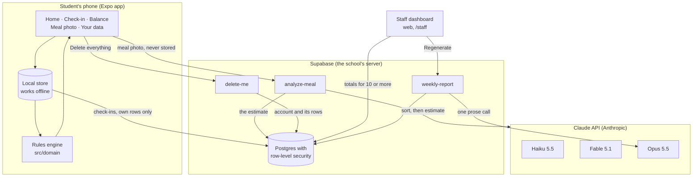
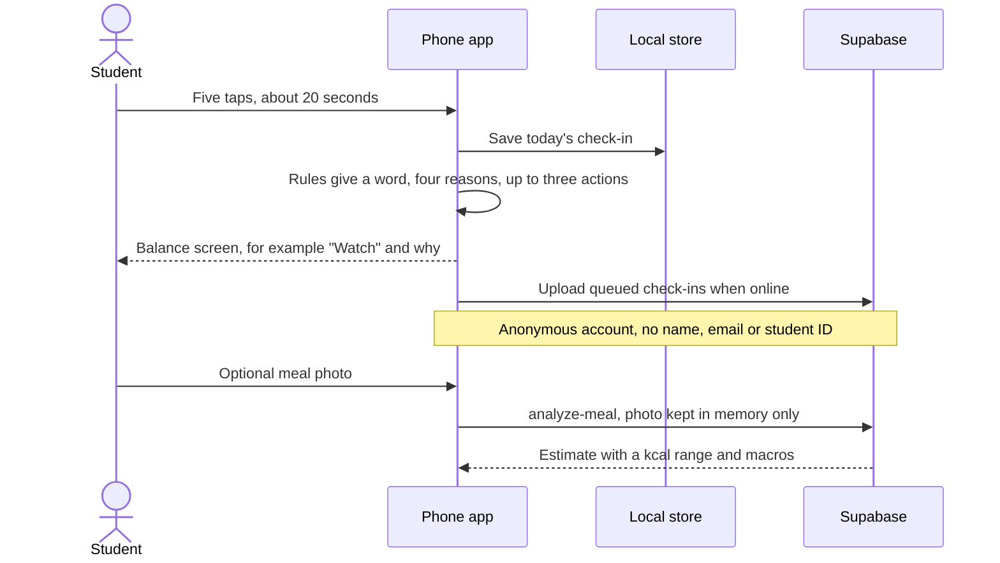
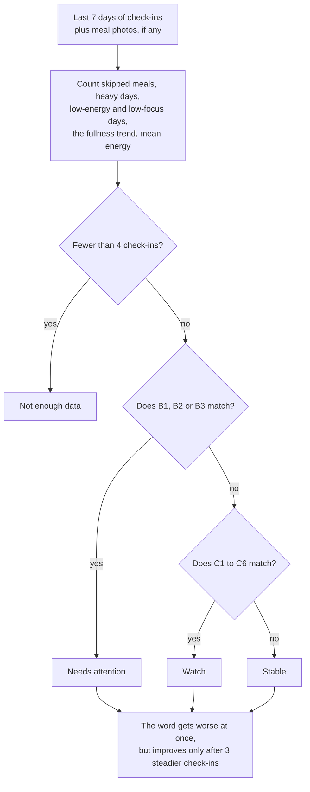
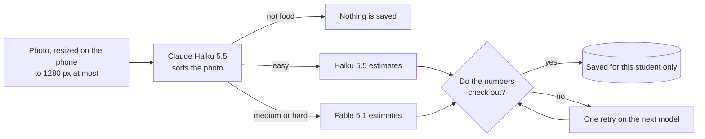
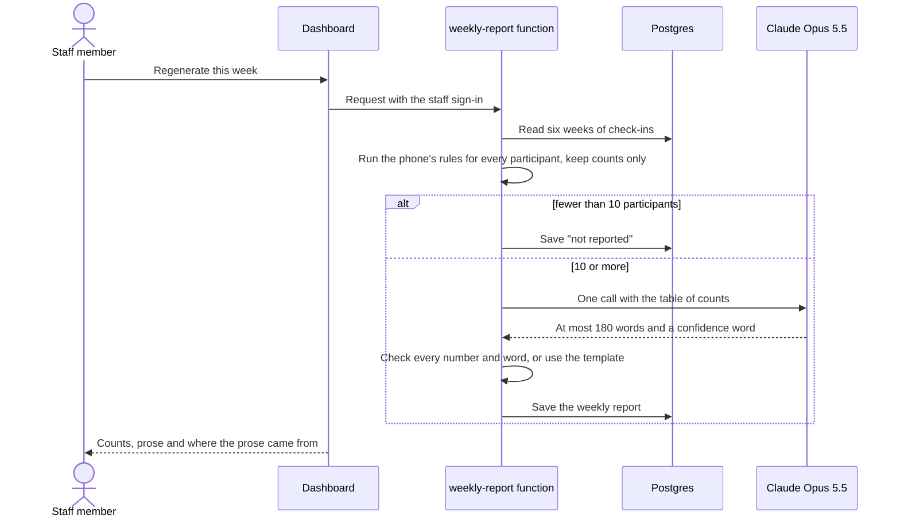

# NourishingX

**A 20-second daily check-in that helps boarding-school students notice when their eating is not keeping up with
their training and classes — and helps the dining hall get better, without ever watching a single student.**

Congressional App Challenge 2027 · New Hampshire. This is a demo build: the school ("Illustrative Boarding School"),
its phone number and its Health Center are made up, and every number on the staff dashboard comes from 60 simulated
students. Nothing here is medical advice, and the app never diagnoses anything.

---

## The idea in one minute

- **Students** answer five quick questions a day: how full they feel, their energy, their focus, whether they trained,
  and whether they skipped a meal. The app turns the last seven days into **one word** — *Stable*, *Watch* or
  *Needs attention* (or an honest *Not enough data*) — with four reasons and up to three small things to try in this
  dining hall.
- **Meal photos are optional.** A photo goes to an AI model that estimates what is on the plate (foods, calories,
  protein, carbohydrate, fat, fibre). The photo itself is thrown away; only the estimate is kept, and only the student
  can see it.
- **Staff** (Dining Services and the Health Center) see **group totals only, and only for groups of 10 or more**.
  No screen, query or export can show one student's answers. That is enforced by the database, not just the app.

## How the pieces fit



Three ideas hold the whole design together:

1. **The phone is the source of truth.** Everything a student enters is saved on the phone first and works with no
   connection. Uploading is a queue that catches up later (`src/store/appStore.ts`).
2. **One rules engine, used everywhere.** The word a student sees comes from fixed rules in `src/domain/rules.ts` —
   not from an AI. The staff report and the staff rule tester import the *same file*, so they can never disagree.
3. **The database protects the data.** Every table has row-level security (RLS): a student's account can only reach
   its own rows, and a staff account can only reach totals computed inside the database. See
   [docs/security-and-privacy.md](docs/security-and-privacy.md).

## A student's day



Every student screen carries the same bar at the bottom: *"This app does not diagnose any condition"* and a
**Health Center** button. A test (`__tests__/screens.test.tsx`) renders every route and fails if either is missing.

## From five taps to one word



The rules are checked **in order** and the first one that matches wins. A real example — the app's "Watch week" demo:

| Day | 1 | 2 | 3 | 4 | 5 | 6 | 7 |
|---|---|---|---|---|---|---|---|
| Fullness | 4 | 4 | 3 | 3 | 3 | 2 | 2 |
| Energy | 4 | 4 | 3 | 3 | 2 | 2 | 2 |
| Training | light | none | moderate | heavy | heavy | heavy | heavy |
| Skipped | — | — | breakfast | — | breakfast | — | breakfast |

Counted: 7 check-ins, skipped meals on 3 days, 4 heavy days, fullness of the last three check-ins minus the four
before = −1.17, mean energy 2.86. No *Needs attention* rule matches (B1 needs 5 skipped days; B3 needs mean energy of
2.2 or lower), so the first *Watch* rule, **C1** (skipped 3+, heavy 4+, fullness falling), wins. The four reasons on
screen are the inputs C1 tested. The full table of rules and where every threshold comes from is in
[docs/how-it-works.md](docs/how-it-works.md) and [docs/thresholds.md](docs/thresholds.md).

## What happens to a meal photo



A cheap, fast model looks first; **code, not a model, decides** which model does the careful estimate. Then code checks
the answer (calories must match the weights and the protein/carbohydrate/fat). We tested every model on 20 weighed
cafeteria dishes: Fable 5.1 was off by 31 % on average, Haiku 5.5 by 52 % and Opus 5.5 by 66 %, so medium and hard
photos go to Fable. The whole router is off by about 40 % on average — which is why students always see a **range**,
labelled as an estimate. Details and every test run: [docs/ai-router.md](docs/ai-router.md).

## Who can see what

| Data | The student who owns it | Another student | A staff account | Anyone without signing in |
|---|---|---|---|---|
| Check-ins | read, write, delete | — | — (0 rows) | — |
| Meal estimates | read, delete | — | — | — |
| Group totals (10 or more students) | — | — | read, through database functions | — |
| Weekly reports | — | — | read | — |
| Dining-hall menu | read | read | read and edit | read |
| AI cost ledger | — | — | totals by model only | — |

"Delete everything" on the phone calls the `delete-me` function, which deletes the anonymous account; a database
trigger then removes every row it owned. The proof is a script that signs in as each kind of user and tries every
boundary: `npm run test:rls` (35 checks).

## The staff dashboard

Open `/staff` in a browser (web only — the phone app does not even contain the dashboard code).

| View | What it answers |
|---|---|
| Weekly overview | How did this week go? Participation, mean ratings, skipped meals, a short report in plain English |
| Menu performance | What do photographed plates contain, by meal? Any average below published guidance? |
| Meal photos & AI | Which models answered, how hard the photos were, and how much of the USD 20 AI budget is spent |
| Menu table & reminder | Enter the menu; phones pick it up on their next sync |
| Aggregate states | How many students saw each word, four weeks of counts, which rules chose them |
| Rule engine | Try the rules yourself — the same function the phone runs |
| Data & consent | What is stored, for how long, what students agreed to, what approvals a pilot still needs |
| Scope guard | What this product will never do, and the build counters that keep it small |



More: [docs/staff-dashboard.md](docs/staff-dashboard.md).

## Run it yourself

You need Node.js 24 and npm. For the phone, install the Expo Go app (or use the web build).

```bash
npm install
npx expo start            # press a (Android), i (iOS simulator) or w (web)
```

Without Supabase settings the app runs in **local-only mode**: check-ins, rules, Balance and demo weeks all work, and
the meal-photo and sync features stay hidden. To connect a Supabase project, put these in `.env.local` (git ignores it):

| Variable | Used by | Secret? |
|---|---|---|
| `SUPABASE_URL` | the app (via `app.config.ts`) and scripts | public |
| `SUPABASE_PUBLISHABLE_KEY` | the app and scripts | public by design — RLS limits it |
| `SUPABASE_SECRET_KEY` | scripts only (tests, seeding, demo staff account) | **secret** |
| `SUPABASE_ACCESS_TOKEN` | the Supabase CLI and `scripts/sql.mjs` | **secret** |
| `ANTHROPIC_API_KEY`, `PROSE_MODEL` | Edge Function secrets only | **secret** |

The full setup — migrations, deploying functions, setting function secrets, the demo staff account and the synthetic
students — is in [docs/development.md](docs/development.md). The short version for an existing project:

```bash
npm run staff:create      # demo staff account, sign-in saved to .env.staff.local
npm run seed:synthetic    # 60 simulated students x 30 days, plus four weekly reports
npx expo export --platform web && npx expo serve    # then open http://localhost:8081/staff
```

## How we know it works

```bash
npm test                  # unit tests: rules, hysteresis, strings, every screen's safety bar, router checks, cohort, prose checks
npm run typecheck && npm run lint
npm run test:rls          # 35 checks against the real database as anonymous, student, other student and staff
npm run check:bundles     # the phone bundle holds no staff code, no Claude SDK, no secret
npm run e2e:student       # a real browser: consent, a real meal photo, sync, delete everything
npm run e2e:staff         # a real browser: sign-in, every view, rule tester, menu editor, report
```

## Project map

```
src/app/            screens (Expo Router): (tabs)/ Home, Check-in, Balance · meal · data · consent · health · how · privacy
src/app/staff/      one-line routes for the web dashboard (pages live in src/ui/staff/pages)
src/domain/         pure logic shared with the server: rules, hysteresis, evidence, balance, cohort report, synthetic cohort
src/store/          the app store: local-first state, sync queue, meal cache
src/services/       Supabase clients, cloud calls, menu, notifications, export, staff calls
src/ui/             theme (the only file with colours and font sizes), building blocks, staff dashboard
src/i18n/           every student string (en.ts), staff strings (staff.ts), the string inventory
supabase/           migrations (tables, RLS, staff functions) and Edge Functions (analyze-meal, weekly-report, delete-me)
scripts/            RLS test, router eval, E2E tests, bundle check, seeding, demo staff account
docs/               explanations for students (start with docs/README.md)
```

## Rules this project never breaks

- The word a student sees comes only from `evaluateRules`; AI never decides it.
- No percentages, scores, decimals or probabilities on the Balance screen; no calorie or weight targets anywhere.
- No streaks, points, weight, body measurements, free text or names.
- The disclaimer and the Health Center button are on every student screen.
- Staff see groups of 10 or more, never one student; nothing notifies an adult about a student.
- Every fact shown (nutrition values, thresholds, guidance) has a source — see [docs/sources.md](docs/sources.md).

## Honest limits

- The rule thresholds are reasoned from published guidance but **not clinically validated**; that is what a pilot with
  the Health Center is for ([docs/thresholds.md](docs/thresholds.md)).
- Photo estimates are rough (about 40 % off on average) and the router has not yet been tested on real student photos.
- There is no automatic end-of-term deletion yet; rows stay until a student deletes them.
- Leaked-password checking for staff accounts needs a paid Supabase plan; staff passwords are random 24-character
  strings created through the Admin API.
- All dashboard numbers today come from simulated students, labelled on every view.

## Credits

- Nutrition values: USDA FoodData Central, SR Legacy. Test photos: Nutrition5k (Google, CC BY 4.0) and Wikimedia
  Commons (authors and licences in `scripts/eval/cases.json`). Guidance: ISSN position stands, ACSM/AND/DC 2016, the
  National Academies' DRIs — all listed with links in [docs/sources.md](docs/sources.md).
- Built with Expo, Supabase and Claude. Decisions and their reasons: [docs/adr/0001-supabase-ai-pivot.md](docs/adr/0001-supabase-ai-pivot.md).
