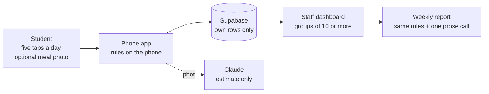

# NourishingX docs — start here

These pages explain how NourishingX works and why it is built the way it is. They are written for students: no
background in databases or AI needed, and every claim points to the file or source behind it.

## Suggested reading order

1. **[how-it-works.md](how-it-works.md)** — the student app, step by step: the check-in, the rules that turn seven
   days into one word, the reasons and actions, why the word doesn't flip, meal photos, offline sync.
2. **[security-and-privacy.md](security-and-privacy.md)** — anonymous accounts, row-level security, why staff only see
   groups of 10 or more, where the keys live, how deleting works, and the test that tries to break it all.
3. **[ai-router.md](ai-router.md)** — how a meal photo is analysed by three Claude models, and the tests behind every
   choice (accuracy, cost, what went wrong and how it was fixed).
4. **[staff-dashboard.md](staff-dashboard.md)** — every staff view, where its numbers come from, the weekly report,
   and the simulated students.
5. **[development.md](development.md)** — run it, connect Supabase, test it, deploy it, fix common problems.

## Reference

- **[thresholds.md](thresholds.md)** — every number the rules use, with its basis and whether it still needs a
  clinician's review.
- **[sources.md](sources.md)** — nutrition values (USDA), the guidance behind the advice, the photos used for testing,
  model prices, and the Supabase behaviour the security depends on.
- **[glossary.md](glossary.md)** — the jargon, in plain English.
- **[adr/0001-supabase-ai-pivot.md](adr/0001-supabase-ai-pivot.md)** — the decision to add Supabase and AI meal photos,
  and what it replaced.
- **[eval/](eval/)** — the raw results of every router test run (JSON).

## The project in one picture

