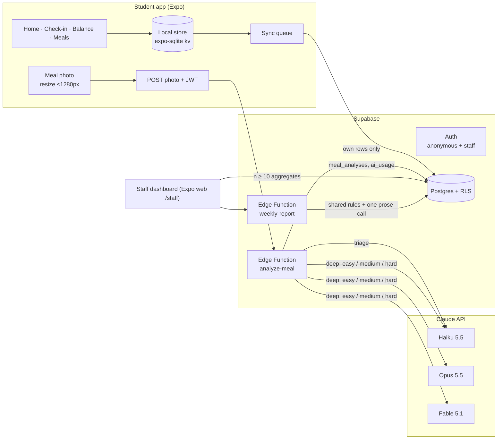

# ADR 0001 — Supabase backend and AI meal analysis

Status: accepted · 2026-10-23 · decided with the project owner

## Context

The first build was a local-only student app (check-in → rule-based Balance word). The owner changed direction:
a real backend, AI analysis of meal photos, a finished staff dashboard, and documentation students can follow.
This record lists what was decided and why, so later work does not re-open it.

## Decisions

| Topic | Decision |
|---|---|
| Backend | Supabase project `jphxdxqzjpgzlgkoayts` (us-west-2). Replaces the plan's Firebase default (D1). |
| Student identity | Supabase anonymous sign-in. No email, name or student ID is ever collected. |
| Staff identity | Email + password accounts created through the Admin API; role in `app_metadata.role = 'staff'`. |
| Meal photos | Optional, taken by students. Resized on the phone, sent in the request body to the `analyze-meal` Edge Function and never written to storage or logs. |
| Numbers | Students see calorie and macro **estimates** for analysed meals (owner's choice). Balance itself stays word-only. |
| AI routing | Claude Haiku 5.5 triages every photo; code picks the deep-analysis model by difficulty: easy → Haiku 5.5, medium → Opus 5.5, hard → Fable 5.1. |
| AI budget | Hard cap of USD 20 across testing and use (`AI_BUDGET_USD`), enforced server-side from the `ai_usage` ledger. |
| Rules | Meal analyses become a new input to `evaluateRules` with researched, cited thresholds (see `docs/thresholds.md`). |
| Docs | English, written for students (README with diagrams + `docs/`). |
| Delivery | Commits pushed straight to `main`. |

## Architecture

## Security model

- **Every table has RLS** and explicit `GRANT`s (new tables are no longer exposed to the Data API automatically — Supabase changelog, 2026-04-28).
- **Students** own their rows: policies combine `to authenticated` with `(select auth.uid()) = user_id`; updates carry both `using` and `with check`.
  Anonymous users hold the `authenticated` role, so no policy relies on the role alone.
- **Staff** never read rows. They call `public.staff_*` wrappers around `private.*` `security definer` functions that check
  `app_metadata.role = 'staff'` and suppress any group with fewer than 10 students. `user_metadata` is never used for authorisation.
- **AI keys** exist only as Edge Function secrets. `ai_usage` and `app_settings` (which holds the budget) have RLS with no client policies.
- **Deletion**: "Delete everything" calls the `delete-me` function, which removes the student's rows and the anonymous auth user.

## LLM router

1. **Triage** (Haiku 5.5, low effort, structured output): is it food, what items are visible, image quality, and difficulty signals
   (mixed dish, hidden oil/sauce, many items, unfamiliar dish, packaged label, poor light).
2. **Route** (code, not a model): difficulty → tier; low triage confidence or poor image moves one tier up; a near-empty budget caps the tier.
3. **Deep analysis** (structured output): items with portion, grams, kcal, protein, carbs, fat, fibre, food group, confidence, plus an energy range.
4. **Validate** (code): schema, totals recomputed from items, energy within ±25 % of 4·P + 4·C + 9·F + 2·fibre, plausible ranges.
   A failed check retries once on the next tier.
5. **Record** the analysis (student's own row) and every model call's tokens and cost (`ai_usage`).

## What this supersedes

From `.omc/plans/nourishingx-v1-production-plan.md`: D1 (Firebase), the "no photos / no calories" exclusions for meal results,
"the only AI call is the weekly batch", and local-only as the only mode. Everything else in the plan (rules, hysteresis, safety bar,
n ≥ 10 suppression, synthetic data for the dashboard, string review) still applies.

## Consequences

- Meal analysis needs a network; check-ins and Balance still work offline.
- Showing calorie estimates to teenagers carries body-image risk; copy states they are estimates, never sets targets, and the Health Center stays one tap away.
- Synthetic students (`cohort = 'synthetic'`) fill the dashboard until a real pilot; every staff view labels them.

## Amendments

- **2026-10-23 · routing by evidence.** The router test (`docs/ai-router.md`) showed Fable 5.1 more accurate than
  Opus 5.5 on every kind of dish (kcal MAPE 0.31 vs 0.66) at a similar speed, so medium photos go to Fable as well:
  easy → Haiku 5.5, medium and hard → Fable 5.1. Opus 5.5 is the retry for a failed Fable answer, the step-down when
  the budget runs low, and the weekly report's writer.
- **2026-10-24 · what the server ended up as.** Three Edge Functions: `analyze-meal`, `delete-me` (accepts anonymous
  students only; the `on_auth_user_deleted` trigger removes their rows) and `weekly-report`, which imports `src/domain`
  directly so the report runs the phone's own `balanceFor`. All three verify callers with `@supabase/server` and have
  the platform's `verify_jwt` off, because the secret key used by scripts is not a JWT.
- **2026-10-24 · the dashboard is not in the phone app.** Expo Router bundles every file in `src/app` on every
  platform, so `/staff` routes re-export `src/ui/staff/pages/<page>`, which Metro resolves to the web page on the web
  and to a stub on phones (`npm run check:bundles` verifies it).
- **2026-10-24 · the menu.** Dining Services edits `menu_days` on the dashboard; phones cache it on sync and fall back
  to the bundled weekly table.
