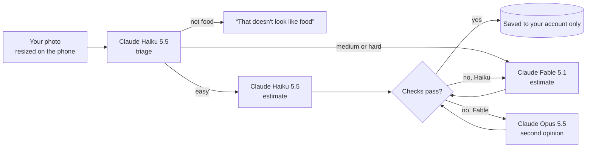

# How NourishingX reads a meal photo

When you add a photo of your meal, three Claude models can be involved. One cheap, fast model looks first and
decides how hard the photo is; then code picks the model that does the careful estimate. This page explains
why it works that way and shows the tests behind every choice.



The photo is never stored. It lives only in the memory of one request to the `analyze-meal` Edge Function
(`supabase/functions/analyze-meal/index.ts`). Only the estimate is saved, in a row only you can read.

## Step by step

1. **Triage** — Claude Haiku 5.5 lists what it sees and marks difficulty signals: a mixed dish, hidden oil or
   sauce, many items, an unfamiliar dish, a packaged label, a poor photo. Thinking is off; it takes about 3 s.
2. **Route** — code, not a model, picks the next model (`TIER_FOR` in `supabase/functions/_shared/meal-router.ts`):
   easy → Haiku, medium or hard → Fable. An easy photo with a low-confidence triage or a poor photo also goes
   to Fable. If the budget is nearly used up, the router steps down to cheaper models.
3. **Estimate** — the chosen model returns every item with its portion, weight in grams, energy density
   (kcal per 100 g), calories, protein, carbohydrate, fat, fibre and a food group, plus a calorie range for the
   whole meal.
4. **Check** — code checks the answer before anyone sees it:
   - calories must match the weight × energy density (±15 %) and the macronutrients (4 kcal/g protein and
     carbohydrate, 9 kcal/g fat, about 2 kcal/g fibre; ±25 %);
   - the macronutrients cannot weigh more than the food;
   - totals are recomputed from the items, and the range must contain the estimate.

   A failed check gets one more try: Haiku's answer goes to Fable, Fable's to Opus.
5. **Record** — every model call writes its tokens and cost to `ai_usage`. The function refuses new photos once
   the project has spent its budget (USD 20) or a student has sent 12 photos in a day.

## How we tested it

`scripts/eval-router.mjs` sends labelled photos through the real, deployed function and scores the answers.

- **20 dishes from Nutrition5k** (Google, CVPR 2021, CC BY 4.0): photos taken from above in a cafeteria, each
  weighed and measured, so we know the true calories and macronutrients. Picked by a seeded draw across four
  complexity bands (1, 2-3, 4-6 and 7+ ingredients).
- **9 photos from Wikimedia Commons** (licences in `scripts/eval/cases.json`): two school-lunch trays, a Finnish
  school lunch, pizza, Caesar salad, a burrito, bibimbap, and two photos that are not food (a cat, a laptop).
  These check item names and food / not-food only.

Scores: **MAPE** is the mean absolute calorie error as a share of the true value (0.40 = 40 % off on average);
**median** is the typical dish; **bias** above 0 means overestimating; **range** is how often the true calories
fall inside the range we show; **recall** is the share of the main ingredients named.

### Each model on the same 20 dishes (prompt v2, model forced)

| Model | kcal MAPE | Median | Bias | Range covers truth | Weight MAPE | Fat error (g) | Cost / photo | Time |
|---|---|---|---|---|---|---|---|---|
| Haiku 5.5 | 0.52 | 0.36 | +46 % | 50 % | 0.52 | 7.1 | $0.001 | 11 s |
| Opus 5.5 (medium effort) | 0.66 | 0.56 | +59 % | 41 % | 0.51 | 5.1 | $0.026 | 13 s |
| Opus 5.5 (high effort) | 0.70 | 0.52 | +63 % | 45 % | 0.47 | 5.3 | $0.026 | 14 s |
| **Fable 5.1 (low effort)** | **0.31** | **0.19** | **+15 %** | **72 %** | **0.27** | **2.6** | $0.045 | 10 s |

Fable was the most accurate in every complexity band. Opus overestimated portions about as much as Haiku did,
at 20 times the cost. That is why the router sends medium photos to Fable rather than Opus; Opus stays as the
second opinion, the budget step-down and the writer of the weekly staff report. (The first design was
easy → Haiku, medium → Opus, hard → Fable; changing `medium` back to `'opus'` restores it.)

### What changed between prompt versions (whole router, all 29 photos)

| Version | Change | kcal MAPE | Median | Bias | Range | Answered | Cost |
|---|---|---|---|---|---|---|---|
| v1 | first prompts | 0.75 | 0.71 | +66 % | 30 % | 28 / 29 | $0.71 |
| v2 | energy density per item; scale cues (plate, bowl, fork, tray); “estimate what you see, not a typical serving”; school dining hall, so no alcohol | 0.64 | 0.25 | +62 % | 53 % | 28 / 29 | $0.81 |
| v3 | explicit “scale” and “size_basis” fields; triage amounts hidden | worse for every model (Fable 0.42, Opus 0.82) — reverted | | | | | |
| **v4** | v2 prompts + route medium photos to Fable | **0.40** | **0.32** | **+31 %** | **55 %** | **29 / 29** | $1.09 |

What the tests caught:

- v1 read a dark berry drink on a Finnish tray as red wine; alcohol's calories broke the check. The prompt now
  says drinks in a school dining hall are never alcohol.
- v1 gave an apple 95 kcal per 100 g (it is 48-52). Asking for the energy density explicitly, and checking it,
  fixed this kind of slip.
- Every model tends to overestimate small portions on photos taken from above. Saying “not a typical serving”
  helped; extra measuring fields in v3 did not.

### Honest limits

- Twenty dishes is a small test. A difference of 0.1 in MAPE between two runs can be noise.
- Nutrition5k photos are small (640 × 480) and taken straight down; phone photos at an angle may behave
  differently. The router has not been tested on real NourishingX student photos yet.
- Calories from a photo are estimates. The app always shows them as a range.
- Total spent on all of these tests: USD 6.01 of the USD 20 budget (from the `ai_usage` ledger).

## Run it yourself

```bash
node --env-file=.env.local scripts/eval-router.mjs --label my-run                 # the router decides
node --env-file=.env.local scripts/eval-router.mjs --label fable --tier fable --source n5k   # force one model
```

Results are written to `docs/eval/<label>.json`. Forcing a model uses the secret key and stores nothing except
the cost rows.
