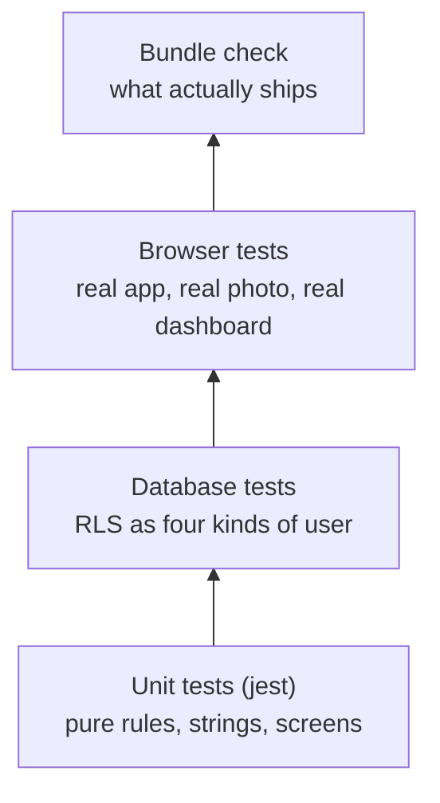

# Developing NourishingX

Everything you need to run, change, test and deploy the project. Commands are run from the project folder.

## Tools

- **Node.js 24** and npm (the scripts use Node's built-in `--env-file` and run `src/domain/*.ts` directly).
- **Expo Go** on a phone, or a simulator, or a browser for the web build.
- **Google Chrome** for the browser tests (`playwright-core` drives your installed Chrome; set `CHROME_PATH` if it is
  somewhere unusual).
- A **Supabase** project if you want sync, meal photos and the dashboard. The Supabase CLI is a pinned dev
  dependency, so you never install it globally.

## Install and run the app

```bash
npm install
npx expo start              # a = Android, i = iOS simulator, w = web
```

With no Supabase settings the app runs in local-only mode (check-ins, rules, Balance, demo weeks).

## Connecting Supabase

Create `.env.local` in the project folder. Git ignores it; never paste these values anywhere else.

```bash
SUPABASE_URL=https://<project-ref>.supabase.co
SUPABASE_PUBLISHABLE_KEY=sb_publishable_...
SUPABASE_SECRET_KEY=sb_secret_...          # scripts only
SUPABASE_ACCESS_TOKEN=sbp_...              # the CLI (a scoped token is best)
ANTHROPIC_API_KEY=sk-ant-...               # becomes an Edge Function secret
PROSE_MODEL=claude-opus-5-5                # model for the weekly staff report
```

`app.config.ts` copies **only** `SUPABASE_URL` and `SUPABASE_PUBLISHABLE_KEY` into the app; a test fails if it ever
reads anything else. The CLI is run through `scripts/env-run.mjs`, which loads `.env.local` into the child process
without printing it:

```bash
node --env-file=.env.local scripts/env-run.mjs supabase link --project-ref <project-ref>
npm run db:push                  # apply supabase/migrations (tables, RLS, staff functions)
npm run functions:deploy -- analyze-meal --project-ref <project-ref>
npm run functions:deploy -- weekly-report --project-ref <project-ref>
npm run functions:deploy -- delete-me --project-ref <project-ref>
```

Function secrets: put the two lines `ANTHROPIC_API_KEY=…` and `PROSE_MODEL=…` in `supabase/.env.local` (ignored by
`supabase/.gitignore`), then

```bash
node --env-file=.env.local scripts/env-run.mjs supabase secrets set --env-file supabase/.env.local --project-ref <project-ref>
```

Also turn on **anonymous sign-ins** for the project: the "Allow anonymous sign-ins" switch in the dashboard's
Authentication settings, or `external_anonymous_users_enabled: true` through the Management API
(`PATCH /v1/projects/<ref>/config/auth`). `supabase/config.toml` records the same setting for local development.

Then the demo data:

```bash
npm run staff:create        # demo staff account; its sign-in goes to .env.staff.local (ignored by git)
npm run seed:synthetic      # 60 simulated students x 30 days up to the latest closed week + four weekly reports (one prose call, about USD 0.013)
```

## The web build and the dashboard

```bash
npx expo export --platform web
npx expo serve              # http://localhost:8081 (student app) and http://localhost:8081/staff
```

The web build is pre-rendered. The student store loads after the page mounts on the web (`src/app/_layout.tsx`), so
the pre-rendered page and the first real frame always match.

## Tests

| Command | What it proves | Needs |
|---|---|---|
| `npm test` | Rules for every clause, hysteresis, evidence and actions, string rules, every student screen's safety bar, the router's checks, cohort counts, the synthetic cohort, prose checks, the store and sync | nothing |
| `npm run typecheck` / `npm run lint` | TypeScript and ESLint are clean | nothing |
| `npm run test:rls` | 47 security boundaries on the real database, including the upload window and closed weeks | `.env.local` |
| `npm run check:bundles` | the phone bundle has no staff code or Claude SDK; no bundle has a secret | `.env.local` |
| `npm run e2e:student [photo.jpg]` | a real browser: consent → anonymous account → a real meal photo (about USD 0.04) → sync → reload → delete everything | a served web build, `.env.local` |
| `npm run e2e:staff` | a real browser: sign-in, every view, word counts equal the stored report, rule tester, menu editor, Regenerate reusing the closed week's report, sign-out | a served web build, the demo staff account, the synthetic cohort |
| `npm run db:advisors` | Supabase's own security and performance checks | `.env.local` |
| `node --env-file=.env.local scripts/eval-router.mjs --label my-run` | the photo router's accuracy on 29 labelled photos (about USD 1) | `.env.local` |

The browser tests read `E2E_BASE_URL` (default `http://localhost:8081`) and save screenshots in `.cache/e2e/`.



## Where things live

| You want to change… | Edit | And keep green |
|---|---|---|
| a rule or threshold | `src/domain/rules.ts` (`TH`) **and** `docs/thresholds.md` | `__tests__/rules.test.ts`, the dashboard rule tester follows automatically |
| words a student reads | `src/i18n/en.ts` | `__tests__/strings.test.ts` |
| staff wording | `src/i18n/staff.ts` | `__tests__/staff-strings.test.ts` |
| colours, font sizes | `src/ui/theme.ts` (the only file allowed literals) | `__tests__/counters.test.ts` |
| things to try per rule | `assets/data/school.json` | `__tests__/evidence-actions.test.ts`, `strings.test.ts` |
| the photo prompts or checks | `supabase/functions/_shared/meal-router.ts` | `__tests__/meal-router.test.ts`, then re-run the eval |
| the weekly report wording | `supabase/functions/_shared/weekly-prose.ts` | `__tests__/weekly-prose.test.ts` |
| who may read what | a new file in `supabase/migrations/` (create it with `supabase migration new`) | `npm run test:rls`, `npm run db:advisors` |
| a staff view | `src/ui/staff/pages/<page>.web.tsx` | `npm run e2e:staff` |

Staff routes are one-line files in `src/app/staff/` that re-export `src/ui/staff/pages/<page>`. Expo Router bundles
every file in `src/app` on every platform, so the real pages sit behind Metro's platform resolution: `<page>.web.tsx`
on the web, a stub `<page>.tsx` (which goes home) on phones.

## Troubleshooting

- **The web build ignores a change to `.env.local`.** Metro caches the inlined app config. Export with `--clear`:
  `npx expo export --platform web --clear`.
- **"Port 8081 is being used by another process".** An earlier `expo serve` is still running. Stop that one process
  (find it with `netstat -ano | findstr :8081` on Windows), or serve on another port with `--port` and set
  `E2E_BASE_URL`.
- **jest says "Cannot use import statement outside a module".** A new ESM-only package needs adding to
  `transformIgnorePatterns` in `jest.config.js` (that is why `standard-navigation` is listed).
- **The rules disagree between the phone and the dashboard.** They cannot: both import `src/domain/rules.ts`. If a test
  says otherwise, a second rule implementation has crept in — `counters.test.ts` checks there is exactly one
  `evaluateRules`.
- **`analyze-meal` answers 429.** Either the project's AI budget is used up (`budget_reached`) or this student sent 12
  photos today (`daily_limit`). Both live in `public.app_settings`.

## Conventions

- Commits: `[Add] …` with the evidence (commands and their results) in the message body.
- Dependencies are pinned to releases at least two weeks old.
- `src/domain` has no React or Expo imports and uses explicit `.ts` imports, because Edge Functions import it too.
- No spinners: long work shows named steps and a timer.
