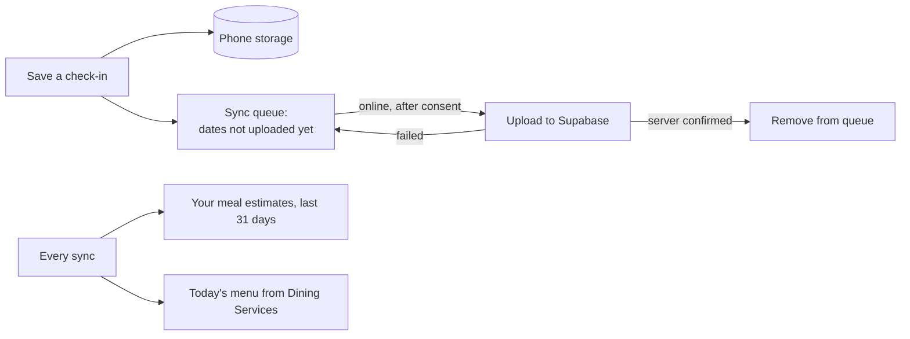

# How the student app works

This page follows one student through the app and explains every decision the app makes, with the file where each
part lives. If you only read one page about the student side, read this one.

## The screens

| Screen | File | What it is for |
|---|---|---|
| Before you start (consent) | `src/app/consent.tsx` | Plain sentences about what happens to your answers (seven when meal photos are on, six in local-only mode), the reminder time, *I understand* / *Not now*. Nothing is stored before this. |
| Home | `src/app/(tabs)/index.tsx` | Today's dining-hall menu, your 7-day averages, one suggestion, today's check-in, the week strip, today's meal photos, a link to Your data |
| Check-in | `src/app/(tabs)/checkin.tsx` | Five questions with a live timer: fullness, energy, focus (1–5), training (none / light / moderate / heavy), skipped meal |
| Balance | `src/app/(tabs)/balance.tsx` | The word for your week, four reasons, up to three things to try, the Health Center |
| Meal photo | `src/app/meal.tsx` | Optional: pick the meal, take or choose a photo, read the estimate |
| Your data | `src/app/data.tsx` | Everything stored, export as CSV, delete one meal estimate or everything, the reminder, demo weeks |
| How this works, Privacy, Health Center | `src/app/how.tsx`, `privacy.tsx`, `health.tsx` | The rules in plain words, where data goes, who to talk to |

Every one of them is built on `Screen` (`src/ui/Screen.tsx`), which always draws the safety bar: *"This app does not
diagnose any condition. It shows patterns in what you entered."* and a **Health Center** button. The only exception is
the Health Center sheet itself, which keeps the sentence and drops the button (you are already there).

## Step 1 — the check-in

Five taps, about twenty seconds. Saving writes one record for today: the five answers and the date. A second save on
the same day replaces the first. The timer is real (`TimerPill` in `src/ui/checkin-widgets.tsx`); the seconds stay on
the phone and are never uploaded.

## Step 2 — counting the last seven days

`derive()` in `src/domain/rules.ts` looks at the seven days ending today and counts:

| Input | Meaning |
|---|---|
| check-ins (`n`) | how many of the 7 days have a check-in |
| skipped | days with any skipped meal |
| heavy days | days with heavy training |
| low-energy days | days with energy 2 or lower |
| low-focus days | days with focus 2 or lower |
| fullness change | mean fullness of the last 3 check-ins minus the mean of up to 4 before them |
| mean energy | the average energy rating |
| meal-photo inputs | photographed main meals, how many were under 10 g protein, heavy days with little carbohydrate |

## Step 3 — the rules, in order

`evaluateRules()` checks these one by one and **stops at the first match**. The order is part of the design: the
serious rules come first.

| Rule | It matches when… | Word |
|---|---|---|
| A | fewer than 4 check-ins | Not enough data |
| B1 | skipped a meal on 5+ days **and** heavy training on 3+ days | Needs attention |
| B2 | energy 2 or lower on 5+ days **and** fullness down by 1.0 or more | Needs attention |
| B3 | skipped 3+, heavy 4+, fullness down 0.5+ **and** mean energy 2.2 or lower | Needs attention |
| C1 | skipped 3+, heavy 4+ **and** fullness falling | Watch |
| C2 | energy 2 or lower on 3+ days **and** skipped 2+ | Watch |
| C3 | fullness down by 1.0+ **and** heavy 2+ | Watch |
| C4 | focus 2 or lower on 4+ days **and** skipped 2+ | Watch |
| C5 | of 4+ photographed main meals, at least 3 in 4 under 10 g protein | Watch |
| C6 | on 2+ heavy days with at least 2 photographed main meals, those meals together had under 60 g carbohydrate | Watch |
| D | nothing above matched | Stable |

The thresholds live in one object, `TH`, at the top of `src/domain/rules.ts`. Where each number comes from — and
which ones still need a clinician's review — is in [thresholds.md](thresholds.md).

**Meal photos can only ever say Watch.** A photo estimate is about 40 % off on average, too rough to say *Needs
attention* on its own. And a meal without a photo never counts against you: the rules only look at what was
photographed.

### Worked examples (the app's demo weeks, computed by the real code)

| Demo week | n | skipped | heavy | low energy | fullness change | mean energy | Rule | Word |
|---|---|---|---|---|---|---|---|---|
| Stable week | 7 | 0 | 2 | 0 | +0.33 | 3.86 | D | Stable |
| Watch week | 7 | 3 | 4 | 3 | −1.17 | 2.86 | C1 | Watch |
| Needs attention week | 7 | 7 | 5 | 5 | −1.00 | 2.14 | B1 | Needs attention |
| Sparse week | 3 | 1 | 1 | 1 | 0 | 2.67 | A | Not enough data |

Try them yourself: *Your data → Demo scenarios* on the phone, or *Rule engine → Load a demo week* on the staff
dashboard. Both run the same function.

## Step 4 — four reasons and up to three things to try

The word never appears alone. `buildEvidence()` (`src/domain/evidence.ts`) shows **four lines chosen by the rule that
matched**: first the inputs that rule tested, then the usual ones (skipped meals, training, fullness, low days) until
there are four. Because the reasons come from the same rule as the word, they cannot disagree with it. The sentences
use whole numbers only ("Skipped a meal on 3 of the last 7 days"), never a score or a percentage.

The actions come from `assets/data/school.json`: at most three per rule, all things you can do in this dining hall
("Add a carb + protein snack after practice"), never a number to eat. The nutrition behind each one is cited in
[sources.md](sources.md#guidance-shown-to-students).

## Step 5 — why the word does not flip every day

`src/domain/hysteresis.ts` replays the last 30 days. The rule for showing a word is:

- a word can get **worse immediately** — the day a worse rule matches, you see it;
- it only gets **better after 3 check-in days in a row** that qualify for the better word (days without a check-in
  don't count — you can't improve a word by not checking in);
- after 7 days in a row of *Not enough data*, the old word is forgotten.

When the word is being held, the Balance screen says so: *"Holding at watch until three steadier days."*

## Step 6 — Needs attention

At *Needs attention* the Balance screen adds a card with the Health Center's number and a *Call* button. On the third
day in a row it becomes firmer — *"This is day 3 in a row at Needs attention. Please talk to someone today"* — and
offers a message you can send yourself. **Nobody is told.** There is no code anywhere that sends a word, a name or an
alert to an adult; the staff dashboard only ever sees counts of 10 or more students.

## Meal photos

1. You choose the meal (breakfast, lunch, dinner or snack) and take or pick a photo.
2. The phone shrinks it so the long edge is at most 1280 pixels (`expo-image-manipulator`), the size the router was
   tested at, and sends it once to the `analyze-meal` function.
3. The screen shows named steps and a timer while it works — never a spinning wheel.
4. You get the foods it saw, an energy **range** ("About 430–650 kcal"), protein, carbohydrate, fat and fibre,
   anything it found hard to judge, and which model made the estimate. Always labelled as an estimate, never a target.
5. The photo is not kept anywhere. The estimate is saved as a row only you can read, and you can delete it.

How the photo is analysed — and how accurate it is — is on its own page: [ai-router.md](ai-router.md).

## Working offline, syncing later

- The app works completely without a connection; only the meal photo needs one.
- After consent, the app signs in **anonymously**: Supabase gives the phone a random account with no name, email or
  student ID. Check-ins are uploaded through the queue (`syncQueueRepo` in `src/data/repos.ts`).
- Demo weeks are never uploaded or exported, and they never mix with your real meal photos.
- **Delete everything** first asks the server to delete the account (the `delete-me` function), which removes every
  row it owned, then wipes the phone. If the server can't be reached, *nothing* is deleted and the app says so — wiping
  the phone first would lose the account you need to delete the server copy.

## The words on the screen

Every sentence a student can read is in `src/i18n/en.ts`. `__tests__/strings.test.ts` rejects any of them that could
read as a diagnosis, a calorie or weight target, a judgement about a body, guilt about a missed day, or a promise the
app cannot keep — for example "risk", "disorder", "calories", "weight", "streak", "missed" or "!". The only exceptions
are listed by name: the disclaimer, the never-collected list, and the meal-estimate lines, which may say "kcal" and the
nutrient "fat" but must pass every other check.
