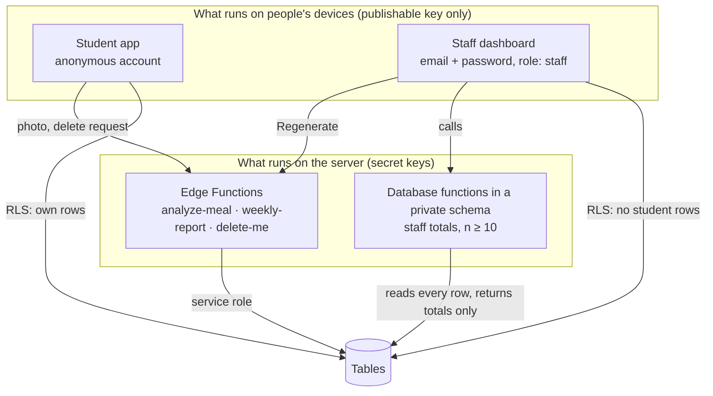

# Security and privacy

NourishingX handles something personal — how much a teenager is eating — so the protections are built into the
database itself, not just the app. This page explains each one and how it is tested.

## The short version

- Students have **anonymous accounts**: a random id, no name, no email, no student ID.
- Every table has **row-level security (RLS)**: the database itself decides which rows a request may touch.
- A student can only ever reach **their own rows**.
- Staff can **never read a row**. They get totals computed inside the database, and only for **groups of 10 or more**.
- Meal photos are **never stored**; only the estimate is.
- The Claude key and the Supabase secret key **never reach a phone or a browser**.
- Every boundary is checked by a script that tries to break it: `npm run test:rls`.

## Who is who



| Who | How they sign in | What the database lets them do |
|---|---|---|
| Student | Anonymous sign-in after consent (`supabase.auth.signInAnonymously()`) | Read, add, change and delete their own check-ins; read and delete their own meal estimates; read the menu |
| Another student | The same | Nothing of yours: their queries return zero of your rows |
| Staff | Email and password, an account created by IT through the Admin API, with `role: staff` in `app_metadata` | Call the `staff_*` total functions, read weekly reports, edit the menu. Reading `checkins` returns 0 rows |
| Anyone else | Nothing | Read the menu. Everything else is refused |
| Edge Functions | The service role, on the server only | Write meal estimates and reports, check the AI budget, delete an account |

## Row-level security, explained

Normally a database checks *whether you may use a table*. RLS adds a second check: *which rows*. Each table gets
**policies** — small rules written in SQL that the database applies to every query. For example, the policy that lets
students read their check-ins (`supabase/migrations/20261023143715_core_schema.sql`):

```sql
create policy "checkins: students read their own rows" on public.checkins
  for select to authenticated using ((select auth.uid()) = user_id);
```

`auth.uid()` is the id inside the student's sign-in token. A row is visible only when its `user_id` matches. Even if
someone changed the app's code, the database would still refuse other students' rows.

Details that matter:

- **Anonymous users count as `authenticated`.** So no policy relies on the role alone; every student policy also checks
  `auth.uid() = user_id`.
- **Updates check twice.** The `using` part decides which rows you may change; the `with check` part checks the row
  after the change, so nobody can move a row to someone else's id. Students also cannot mark their rows as `synthetic`.
- **Students cannot invent meal estimates.** Only the `analyze-meal` function (service role) can insert them, so the
  staff totals cannot be faked from a phone.
- **Exact privileges.** New Supabase tables are no longer open to the Data API by default, so every migration grants
  exactly what the policies need — nothing more. The test compares the live privileges with the expected list.
- **Staff are decided by `app_metadata`.** `user_metadata` can be edited by the user, so it is never used to decide
  anything. Staff must also be permanent (non-anonymous) accounts.

## Totals of 10 or more

Staff numbers come from `private.staff_overview`, `staff_daily`, `staff_meals` and `staff_ai_spend`
(`supabase/migrations/20261023143717_staff_aggregates.sql`). These are **security-definer** functions: they run with
the database owner's rights so they can read every row — which is exactly why they are careful:

1. They live in a `private` schema that the API does not expose; the app calls thin `public` wrappers.
2. The first line of each one checks the staff role and stops if it is missing.
3. Any group with fewer than 10 different students is dropped: the answer says only how many students there were and
   `suppressed: true`. The same 10 is used by the weekly report (`MIN_GROUP` in `src/domain/cohort.ts`).
4. They return totals and averages — never an id, a date-by-student list or a single answer.

Why 10? With very small groups, a total can point to one person ("the only student in the robotics club who…").
Ten is the threshold the original plan set; the test checks that every day under 10 students comes back with no
averages at all.

## Meal photos

- The phone shrinks the photo and sends it in the body of one request to `analyze-meal`.
- The function passes it to Claude and keeps it only in memory; it is not written to storage, the database or logs.
- Only the validated estimate is saved, as the student's own row.
- Each photo's cost goes into the `ai_usage` ledger. The function refuses new photos when the project's USD 20 budget
  would be passed or a student has sent 12 photos in the last 24 hours.

What leaves the school's server: the photo goes to Anthropic's Claude API to be analysed. The Privacy screen tells
students this before they take a photo, and consent says it in plain words.

## Keys

| Key | Where it lives | Can it be in an app? |
|---|---|---|
| Supabase URL and **publishable** key | The app (through `app.config.ts`) | Yes — public by design; RLS limits what it can do |
| Supabase **secret** key | `.env.local` for scripts; the server | Never |
| Supabase access token | `.env.local` for the CLI | Never |
| Anthropic API key | An Edge Function secret | Never |

`npm run check:bundles` builds the phone and web bundles and confirms that none of the secret values appears in them,
and that the phone bundle contains no staff code and no Claude SDK at all. `__tests__/counters.test.ts` checks the
source: `app.config.ts` reads only the two public settings, and only one file imports the Claude SDK.

## Deleting

*Your data → Delete everything* calls the `delete-me` function with the student's sign-in. The function accepts only
anonymous students and deletes the account; the `on_auth_user_deleted` database trigger then deletes the student's
check-ins and meal estimates and removes the student id from AI cost rows. Only then does the phone wipe itself.

## How it is tested

`npm run test:rls` (`scripts/rls-test.mjs`) creates two anonymous students and a staff account on the real project
and tries 35 things, for example:

- someone with no sign-in cannot read check-ins;
- student B cannot read, change or delete student A's rows;
- a student cannot insert a meal estimate, mark a row synthetic, read the AI ledger or call a staff function;
- staff read 0 check-in rows, cannot read the raw AI ledger, and get totals only;
- a day with fewer than 10 students comes back with no averages;
- `delete-me` refuses staff and callers without a sign-in, and deleting removes the rows;
- the table privileges match the expected list exactly.

The test deletes the accounts it made when it finishes.

## Known gaps

- **Leaked-password protection** (checking staff passwords against known breaches) needs a paid Supabase plan; the
  project's attempt to turn it on returned HTTP 402. Staff passwords are random 24-character strings made by
  `scripts/create-staff.mjs`.
- **No automatic end-of-term purge yet.** Rows stay until the student deletes them.
- **Access tokens outlive deletion briefly.** Deleting an account does not cancel a token already issued; the phone
  signs out locally right after, and tokens expire on their own.
- The database advisor still lists "anonymous access" on `checkins` and `meal_analyses`. That is intended: every
  student is anonymous, and each of those policies pins rows to `auth.uid()`.
