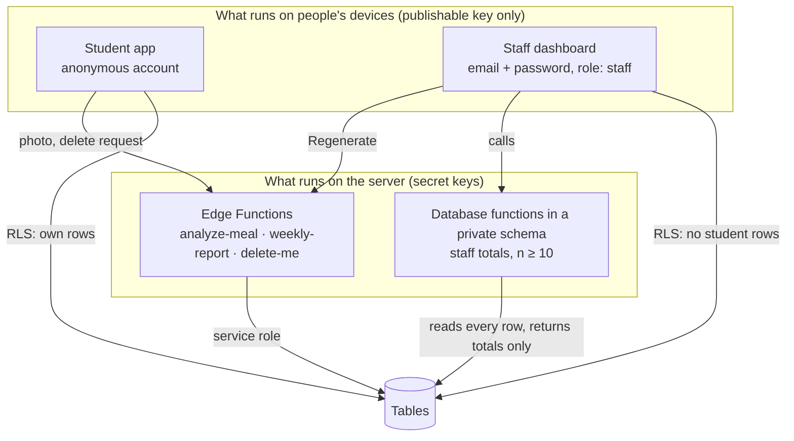

# Security and privacy

NourishingX handles something personal — how much a teenager is eating — so the protections are built into the
database itself, not just the app. This page explains each one and how it is tested.

## The short version

- Students have **anonymous accounts**: a random id, no name, no email, no student ID.
- Every table has **row-level security (RLS)**: the database itself decides which rows a request may touch.
- A student can only ever reach **their own rows**, and can only send check-ins for **the last 2 days**.
- Staff can **never read a row**. They get totals computed inside the database, only for **groups of 10 or more**, and
  only for **weeks that are already closed**, so two totals can never be subtracted to reveal one check-in.
- Meal photos are **never stored**, not even on the phone; only the estimate is.
- The Claude key and the Supabase secret key **never reach a phone or a browser**.
- Every boundary is checked by a script that tries to break it: `npm run test:rls`.

## Who is who



| Who | How they sign in | What the database lets them do |
|---|---|---|
| Student | Anonymous sign-in after consent (`supabase.auth.signInAnonymously()`) | Read and delete their own check-ins, and add or change them for the last 2 days (school time); read and delete their own meal estimates; read the menu |
| Another student | The same | Nothing of yours: their queries return zero of your rows |
| Staff | Email and password, an account created by IT through the Admin API, with `role: staff` in `app_metadata` | Call the `staff_*` total functions, read weekly reports, edit the menu. Reading `checkins` returns 0 rows |
| Anyone else | Nothing | Read the menu. Everything else is refused |
| Edge Functions | The service role, on the server only | Write meal estimates and reports, reserve AI budget, delete an account |

## Row-level security, explained

Normally a database checks *whether you may use a table*. RLS adds a second check: *which rows*. Each table gets
**policies** — small rules written in SQL that the database applies to every query. For example, the policy that lets
students read their check-ins (`supabase/migrations/20261023143715_core_schema.sql`):

```sql
create policy "checkins: students read their own rows" on public.checkins
  for select to authenticated using ((select auth.uid()) = user_id);
```

`auth.uid()` is the id inside the student's sign-in token. A row is visible only when its `user_id` matches. Even if
someone changed the app's code, the database would still refuse other students' rows.

Details that matter:

- **Anonymous users count as `authenticated`.** So no policy relies on the role alone; every student policy also checks
  `auth.uid() = user_id`.
- **Updates check twice.** The `using` part decides which rows you may change; the `with check` part checks the row
  after the change, so nobody can move a row to someone else's id. Students also cannot mark their rows as `synthetic`.
- **Students cannot invent meal estimates.** Only the `analyze-meal` function (service role) can insert them, so the
  staff totals cannot be faked from a phone.
- **Exact privileges.** New Supabase tables are no longer open to the Data API by default, so every migration grants
  exactly what the policies need — nothing more. The test compares the live privileges with the expected list.
- **Staff are decided by `app_metadata`.** `user_metadata` can be edited by the user, so it is never used to decide
  anything. Staff must also be permanent (non-anonymous) accounts.

## Totals of 10 or more, for closed weeks only

Staff numbers come from `private.staff_overview`, `staff_daily`, `staff_meals` and `staff_ai_spend`
(`supabase/migrations/20261023143717_staff_aggregates.sql`, rebuilt in
`supabase/migrations/20261023173407_staff_closed_weeks.sql`). These are **security-definer** functions: they run with
the database owner's rights so they can read every row — which is exactly why they are careful:

1. They live in a `private` schema that the API does not expose; the app calls thin `public` wrappers.
2. The first line of each one checks the staff role and stops if it is missing.
3. Any group with fewer than 10 different students is dropped, and so is its exact size: the answer says only
   `suppressed: true` with `students: null`. The same 10 is used by the weekly report (`MIN_GROUP` in
   `src/domain/cohort.ts`).
4. They return totals and averages — never an id, a date-by-student list or a single answer.

Why 10? With very small groups, a total can point to one person ("the only student in the robotics club who…").
Ten is the threshold the original plan set.

### Why "closed weeks"

A threshold alone is not enough. A security review on 2026-10-24 showed that two allowed totals could be
**subtracted** to recover one student's answers — for example the week's total minus the six days that were shown
leaves the one quiet day that was hidden, or an 8-day window minus a 7-day window leaves a single day. Totals that
were live also changed the moment a student checked in, so asking just before and just after gave that check-in
away. So every staff number now follows three rules:

| Rule | What it stops |
|---|---|
| **Closed weeks only.** Staff see the latest Monday-to-Sunday week whose Sunday is *final*: no check-in or meal photo can still arrive for it (see the upload window below). There is no window to choose. | Overlapping windows, and before/after polling |
| **Shown days only.** A day is part of a week's totals, and its students count as participants, only if it has 10 or more students of its own; a quieter day is left out, never subtracted. | "Week minus the visible days", and two participant counts that differ by the one student seen only on a quiet day |
| **No small exact counts.** A suppressed group carries no count at all, not even "3 students". | Aiming an attack at a tiny group |

The daily chart ends on the last final day, and the weekly report (`weekly-report`) uses the same closed weeks, so a
report never changes once written and two reports never overlap.

The meal-photo numbers follow one more rule (`supabase/migrations/20261023185644_staff_meals_shared_rows.sql`):
**every number covers the same photos**, those of meal slots with 10 or more participants of their own. Otherwise the
total minus the slots that are shown would give the hidden slot's count back. The tables of which model answered and
how hard the photos were split those same photos a second and a third way, so each table appears only when none of
its groups is small.

**Simulated students.** The synthetic cohort counts toward the 10 like anyone else, and anyone with the code can
regenerate its answers (seed 2027). On a day shared with real students, subtracting the simulated answers would give
the real ones back. So the two never share a day: real students can write only the open days, the seed writes only
closed ones, and `npm run seed:synthetic` refuses to run over days that already hold real rows.

**The one exception.** Inside a reported week (which already has 10 or more participants), the weekly report keeps
the exact number of participants at each Balance word, which rule chose the word, and how many were at *Needs
attention* 3 or more days in a row — even when that number is 1. The Health Center needs to know that someone may
need support, and a count names no one: there is no list, query or export behind it (see "Not hidden — not built" on
the dashboard). Every other small group, such as the participants who photographed a meal, is dropped.

### The upload window

Students can add or change a check-in only for **today and the 2 days before** (school time, New Hampshire), plus
tomorrow for a phone whose clock is ahead (`private.upload_days()`; `UPLOAD_DAYS` in `src/domain/time.ts`). A day is
final three days after it ends. Without this, throwaway accounts could write rows for any date: pad a quiet day to 10
fake students and subtract their known answers, or quietly change last month's totals. The phone keeps an older
check-in for the student and simply stops trying to upload it.

## Meal photos

- The phone shrinks the photo and sends it in the body of one request to `analyze-meal`. The picker's copy and the
  shrunk file, which the phone's photo tools leave in the app cache, are deleted as soon as the photo is read
  (`src/services/photo-files.ts`).
- The function passes it to Claude and keeps it only in memory; it is not written to storage, the database or logs.
- Only the validated estimate is saved, as the student's own row. The student gets back the estimate and nothing
  else: which models ran, why, and what it cost stay in the ledger.
- Before every Claude call the function **reserves** that call's worst-case cost in the `ai_usage` ledger, inside a
  database lock (`private.reserve_ai`), and afterwards sets the row to the real cost. A reservation is refused when the
  project's USD 20 budget would be passed or a student has sent 12 photos in the last 24 hours. Because of the lock,
  thirty photos sent at the same moment cannot all slip under the cap.
- Error answers from the functions are trimmed to a code and a message (`errors: { detailed: false }`), so they do not
  describe the server's setup.

What leaves the school's server: the photo goes to Anthropic's Claude API to be analysed. The Privacy screen tells
students this before they take a photo, and consent says it in plain words.

## Keys

| Key | Where it lives | Can it be in an app? |
|---|---|---|
| Supabase URL and **publishable** key | The app (through `app.config.ts`) | Yes — public by design; RLS limits what it can do |
| Supabase **secret** key | `.env.local` for scripts; the server | Never |
| Supabase access token | `.env.local` for the CLI | Never |
| Anthropic API key | An Edge Function secret | Never |

`npm run check:bundles` builds the phone and web bundles and confirms that none of the secret values appears in them,
and that the phone bundle contains no staff code and no Claude SDK at all. `__tests__/counters.test.ts` checks the
source: `app.config.ts` reads only the two public settings, and only one file imports the Claude SDK.

## Deleting

*Your data → Delete everything* calls the `delete-me` function with the student's sign-in. The function accepts only
anonymous students and deletes the account; the `on_auth_user_deleted` database trigger then deletes the student's
check-ins and meal estimates and removes the student id from AI cost rows. Only then does the phone wipe itself.

The order matters, and a few details keep it honest:

- The phone first waits for any upload still running and starts no new one, so nothing arrives after the wipe.
- The phone keeps its sign-in until `delete-me` says the account is gone. If the network drops halfway, the toast
  says nothing was deleted and *Delete everything* can simply be pressed again; a repeat answers "deleted" even if
  the first attempt had already succeeded.
- A sign-in token stays valid for up to an hour after the account is deleted. A database trigger
  (`private.require_live_user`) refuses any real check-in or meal estimate whose account no longer exists, so an
  upload or a photo analysis that was still in flight is not stored.

## How it is tested

`npm run test:rls` (`scripts/rls-test.mjs`) creates two anonymous students and a staff account on the real project
and tries 44 things, for example:

- someone with no sign-in cannot read check-ins;
- student B cannot read, change or delete student A's rows;
- a student cannot insert a meal estimate, mark a row synthetic, read the AI ledger, reserve AI budget or call a
  staff function;
- a check-in from 2 days ago is accepted, but one 10 days old or 3 days ahead is refused;
- staff read 0 check-in rows, cannot read the raw AI ledger, and get totals only — for the latest closed
  Monday-to-Sunday week, with no count when suppressed;
- a day with fewer than 10 students comes back with neither its count nor its averages, and the daily list ends on
  the last final day;
- a deleted student's still-valid token cannot write a check-in, and no meal estimate is stored for a deleted account;
- `delete-me` refuses staff and callers without a sign-in, deleting removes the rows, and a repeat still answers
  "deleted";
- the table privileges match the expected list exactly.

The test deletes the accounts it made when it finishes.

## Known gaps

- **Leaked-password protection** (checking staff passwords against known breaches) needs a paid Supabase plan; the
  project's attempt to turn it on returned HTTP 402. Staff passwords are random 24-character strings made by
  `scripts/create-staff.mjs`.
- **No automatic end-of-term purge yet.** Rows stay until the student deletes them.
- **A deletion can still change a closed week.** When a student deletes a meal estimate, a check-in or the whole
  account, those rows leave the live staff totals for weeks that were already closed, so a staff member comparing
  the same week before and after could learn something about that one student. Stored weekly reports do not change
  (an AI report of a closed week is final), but the overview's live totals do. Freezing each closed week's totals in
  a table when the week closes would remove this; it is the next privacy step, and students keep the right to delete.
- **Staff sign-in is a password only.** There is no second factor (MFA) yet, and the dashboard is served from the same
  web address as the student web app without a Content Security Policy. To limit the damage, the staff session is
  kept in the browser tab's `sessionStorage` and ends when the tab closes. Serving `/staff` from its own address with
  strict headers, and turning on MFA, are the next steps.
- **Anonymous sign-ins have no CAPTCHA.** Supabase limits them to 30 an hour per IP address by default (Auth rate
  limits), and every photo is paid for out of
  one lifetime budget, so a determined person could still spend the budget with many accounts — slowly, and never
  past the cap. A CAPTCHA and a monthly budget would help.
- **Dependencies.** `npm audit` (2026-10-24) reports 4 high and 6 moderate advisories, all inside Expo's tooling:
  `node-forge` and `uuid` are used only when building the app, and `decode-uri-component` (via `expo-router`) could
  at worst slow a page given a crafted link. They go away with Expo patch releases. The Edge Functions' dependencies
  are pinned in `deno.lock` but not audited by a tool.
- The database advisor still lists "anonymous access" on `checkins` and `meal_analyses`. That is intended: every
  student is anonymous, and each of those policies pins rows to `auth.uid()`.
