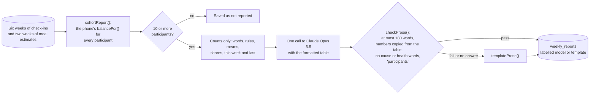

# The staff dashboard

Dining Services and the Health Center use a web dashboard at `/staff`. It answers questions about **groups** — how
the week went, what is on photographed plates, whether a menu change helped — and it is built so it *cannot* answer
questions about one student. This page explains every view, where each number comes from, and the weekly report.

## Signing in

Staff accounts are created by the school's IT with the Supabase Admin API — there is no sign-up page. For the demo:

```bash
npm run staff:create        # makes dining.demo@example.com and saves its password to .env.staff.local
```

The role is stored in `app_metadata.role = 'staff'`, which only the server can set. Signed out, any `/staff` address
shows the sign-in form in place, and the page you asked for opens once you are in. The dashboard keeps its sign-in
under its own storage key, so it never replaces a student session in the same browser.

## Every view

| View | Route | What it shows | Where the numbers come from |
|---|---|---|---|
| Weekly overview | `/staff` | Participants, check-ins each, mean energy / fullness / focus (with last week), skipped meals, heavy training; the weekly report in prose; 30 days of daily means; energy by day of week | `staff_overview(7)`, `staff_daily(30)`, the latest row of `weekly_reports` |
| Menu performance | `/staff/menu` | Photographed meals by slot (photos, participants, average kcal, protein, carbohydrate, fat, fibre); food groups on plates; actions when an average falls below published guidance; today's menu | `staff_meals(7)`, `menu_days` |
| Meal photos & AI | `/staff/meals` | Which model did the deep analysis, how hard the photos were, low-confidence estimates, AI spend against the USD 20 cap, the router test result | `staff_meals(7)`, `staff_ai_spend()`, [ai-router.md](ai-router.md) |
| Menu table & reminder | `/staff/ops` | Edit the weekday and weekend templates or a dated day; the reminder policy | `menu_days` (staff can edit; everyone can read) |
| Aggregate states | `/staff/wellness` | How many participants saw each word this week, three or more days at Needs attention, four weeks as counts, which rule chose the word | the last four rows of `weekly_reports` |
| Rule engine | `/staff/rules` | A tester over the rule inputs, demo weeks, the rules in order with the matching one highlighted, where each threshold comes from | `evaluateRules` from `src/domain/rules.ts` — the phone's own function |
| Data & consent | `/staff/data` | What is stored and never collected, retention, re-identification controls, the consent sentences, approvals a pilot still needs | the code and `src/i18n/en.ts` |
| Scope guard | `/staff/scope` | Ten things this product will never do and what to say if someone asks; the build counters; weekly review questions | `src/domain/counters.ts` (checked against the code by a test) |

Every view shows a dark banner while simulated students are in the numbers:
*"Synthetic data · all 60 participants this week are simulated students…"*.

### Why there is no list of students

The Aggregate states view ends with the hardest design question: should the Health Center be told when a student
reaches *Needs attention*? In this build the answer is **no — not hidden, not built.** There is no screen, query or
export that lists students by word, and a staff account cannot read a single check-in. The student sees the Health
Center's number and decides. If a school ever wanted alerts, that would be a new feature with its own approval, not a
setting.

## The weekly report



The `weekly-report` Edge Function (`supabase/functions/weekly-report/index.ts`) imports the student app's own rule
code from `src/domain` — the Supabase CLI uploads those files with the function — so a word can never differ between
the phone and the report.

The one AI call sees **only the table of counts**, never a row. Its instructions (`PROSE_SYSTEM` in
`supabase/functions/_shared/weekly-prose.ts`) say: describe, don't explain; use only numbers from the table, copied
exactly; no health or diagnostic language; never single out a person; give the four word counts first; end with one
thing about the group or the dining hall worth watching. Then `checkProse()` checks the answer in code, and anything
that fails is replaced by `templateProse()`, which passes the same checks (tested in `__tests__/weekly-prose.test.ts`).
Each report is labelled with where its prose came from, the model, the time and a confidence word with its reason.

A real report from the synthetic cohort (Claude Opus 5.5, about USD 0.015):

> This week (2026-10-17 to 2026-10-23), all 60 participants are simulated, so these figures describe test data, not
> real participants. There were 321 check-ins. Balance words: Stable 54, Watch 3, Needs attention 1, Not enough data 2.
> Participants at Needs attention 3 or more days in a row: 1. …
>
> *Confidence: Low — all 60 participants are simulated and only two weeks are available, so the pattern is suggestive
> only.*

**Regenerate** on the overview runs the function for the current week. If a model report was written in the last 15
minutes, that one is shown again instead of paying for another call.

## The synthetic cohort

Until a pilot, the dashboard runs on simulated students (`src/domain/synthetic.ts`, seed 2027). The shape follows the
plan:

- 60 students × 30 days; athletes 35 %, breakfast-skippers 30 %, new boarders 25 %;
- 60 % check in 5–7 days a week, the rest 4–5, and exactly two "sparse" students 2–3 days, so *Not enough data* shows;
- exam week on days 15–19 (energy −0.4, focus −0.5, skipping +12 points); the training season starts on day 8;
- three students drift to *Watch* and one to *Needs attention* in the last week;
- 40 % of students photograph about half of their main meals; every synthetic plate is built only from the USDA foods
  listed in [sources.md](sources.md), so its numbers are traceable.

`npm run seed:synthetic` replaces the synthetic rows with a fresh 30 days ending today and writes the last four weekly
reports. Every synthetic row is stored with `cohort = 'synthetic'`; students cannot create such rows.
`__tests__/synthetic.test.ts` checks that the same seed always gives the same cohort, the profile mix, the two sparse
students, every word present on the last day, Watch plus Needs attention at most 20 %, and a visible exam week.

## The menu

Dining Services edits the weekday and weekend templates or any date in *Menu table & reminder*. Phones fetch today's
entry and both templates on every sync and keep them for offline use. A dated entry wins over the template, which wins
over the table bundled with the app (`menuForToday` in `src/services/menu.ts`).

## Tested by

- `npm run e2e:staff` — a real browser signs in, refuses a wrong password, opens every view, checks that the word
  counts on the page equal the stored report, loads each demo week in the rule tester, saves a menu day that a phone
  can then read (and deletes it), regenerates the report, tries a narrow window and signs out.
- `npm run test:rls` — staff get totals but no rows, and students cannot run the weekly report.
